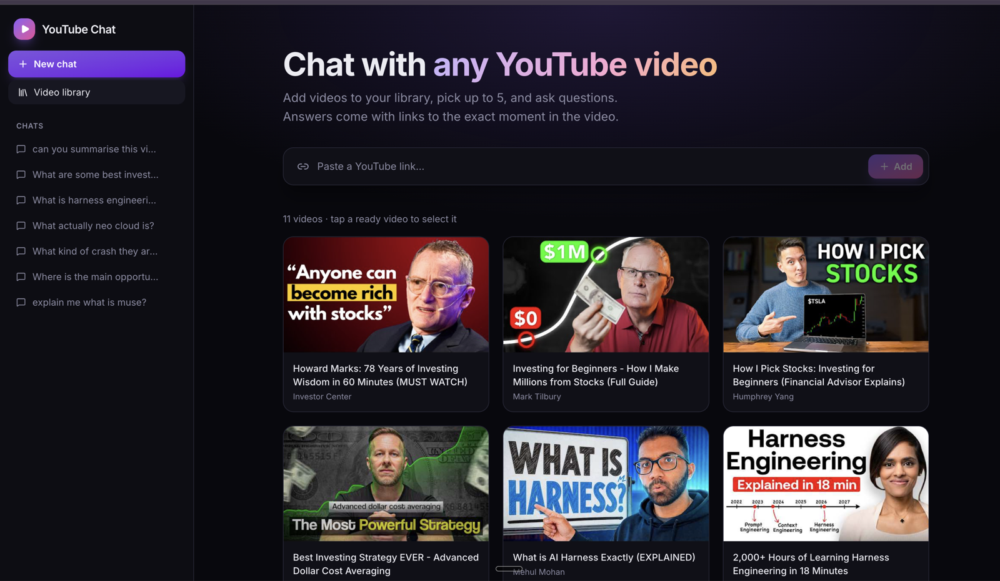
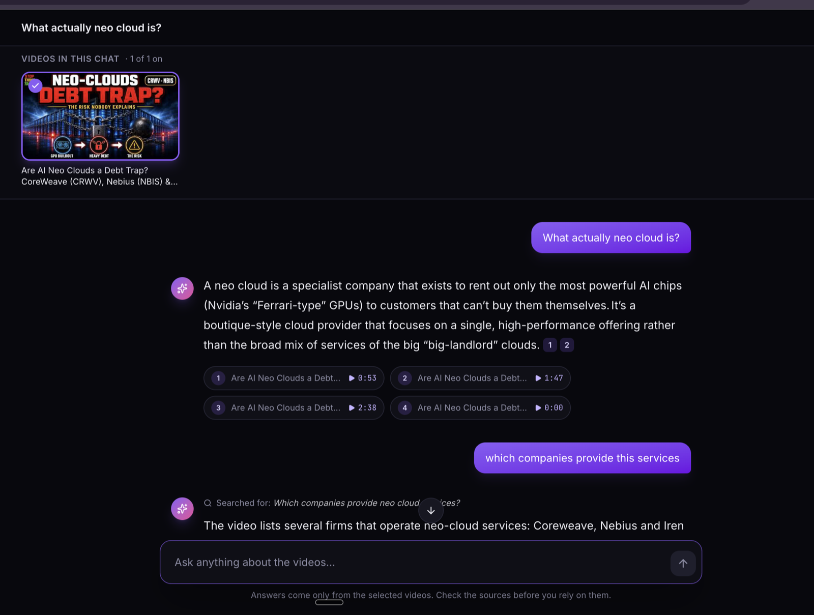
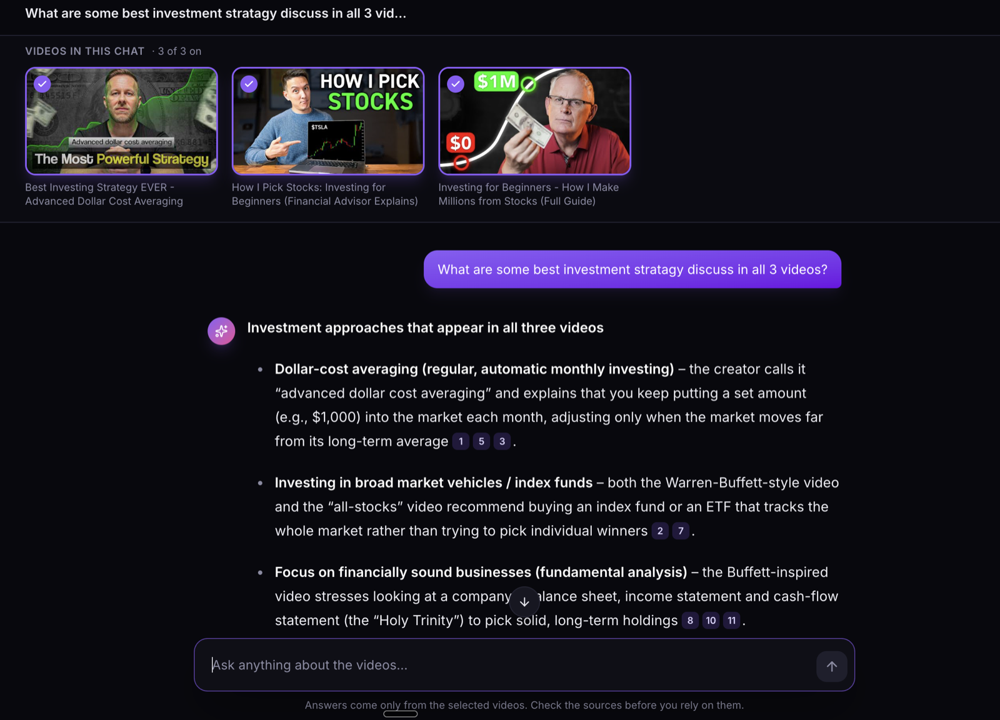

# YouTube Chat

Chat with one or more YouTube videos using retrieval-augmented generation (RAG).
Paste a URL, build a personal library, select up to 5 videos, and hold a continuous conversation grounded in their transcripts.

## Screenshots



Pick up to 5 videos from your library and ask. Every answer cites the passages it used, with a link to that moment in the video.



A follow-up such as "which companies provide this services" is rewritten into a standalone question using the chat history (shown as "Searched for") so the search still knows the topic.



## How well does it work?

Retrieval is measured, not judged by eye: a fixed set of 86 questions labelled with transcript quotes. Every change (hybrid search, a reranker, query expansion, chunk sizes, parent-child retrieval) is a logged experiment with its numbers, including the ones that did not help. See [docs/EXPERIMENTS.md](docs/EXPERIMENTS.md) and [docs/EVAL.md](docs/EVAL.md).

## Stack

- **Backend:** Node.js, Express, TypeScript, LangChain
- **Vector store:** Qdrant
- **Database:** PostgreSQL with Prisma ORM
- **LLM and embeddings:** Groq (answers) and Google Gemini (embeddings, answer fallback), both on free tiers
- **Frontend:** React, Vite, Tailwind CSS, Framer Motion, TanStack Query

## Getting started

Requirements: Node.js 22+, Docker.

```bash
cp .env.example .env        # then fill in GOOGLE_API_KEY (embeddings) and GROQ_API_KEY (answers, recommended)
docker compose up -d        # starts Qdrant and PostgreSQL
npm install
npm run db:migrate --workspace server  # creates tables and generates the Prisma client
npm run dev:server          # API on http://localhost:8080
npm run dev:client          # app on http://localhost:5173 (proxies /api to the server)
```

Open http://localhost:5173, paste a YouTube link, wait for the video to become ready, select it and start a chat.

## Commands

Run these from the repo root unless a section says otherwise.

### App

```bash
docker compose up -d                  # start Qdrant and PostgreSQL
npm run dev:server                    # API on http://localhost:8080
npm run dev:client                    # app on http://localhost:5173
npm run build --workspace client      # type-check and build the web app
```

### Checks

```bash
npm run lint                          # ESLint, server and client
npm run typecheck                     # TypeScript, server (including scripts/) and client
npm test                              # unit tests, server and client
npm run format                        # Prettier, rewrite files
npm run format:check                  # Prettier, check only
```

### Database

```bash
npm run db:migrate --workspace server   # create a migration, apply it, regenerate the Prisma client
npm run db:generate --workspace server  # regenerate the Prisma client only
npm run db:deploy --workspace server    # apply existing migrations (no new migration)
```

### Evaluation

Retrieval is scored on a fixed question set (hit rate, recall, precision, nDCG, MRR) so every change can be compared by numbers. Needs Qdrant running, the eval videos ingested and `GOOGLE_API_KEY` set.

```bash
npm run eval --workspace server                                  # score retrieval, compare with the baseline
npm run eval --workspace server -- --label hybrid                # name the run
npm run eval --workspace server -- --strategy hybrid             # search strategy: dense (default) or hybrid
npm run eval --workspace server -- --strategy hybrid --sparse-weight 0.3   # hybrid, exact-word list counts 0.3 (default 1)
npm run eval --workspace server -- --reranker minilm              # re-order results with a local model: minilm or bge-m3
npm run eval --workspace server -- --expansion multi --reranker none   # LLM-written extra search texts: hyde, hyde+q or multi
npm run eval --workspace server -- --chunking 500/100 --budget 10000   # another chunk size (ingest it first: npm run ingest:eval -- --chunking 500/100)
npm run eval --workspace server -- --chunking 500/100 --parent 2000/400   # parent-child: search small chunks, return bigger ones
npm run eval --workspace server -- --only q42-q86                # score only some questions (ids and ranges)
npm run eval --workspace server -- --save-baseline               # keep this run as the one to beat
npm run eval --workspace server -- --against eval/runs/<file>.json   # compare with another saved run
npm run eval:answers --workspace server -- --reranker bge-m3 --only q42-q56   # answer-level check: refusals and citations (uses answer-model quota)
npm run eval:compare --workspace server -- <before.json> <after.json>  # compare any two saved runs
```

Check the labels, run from `server/`:

```bash
npx tsx --env-file=../.env scripts/eval-review.ts           # every question
npx tsx --env-file=../.env scripts/eval-review.ts q03 q07   # only these
```

How it works, how to read the output and how to check the labels: [docs/EVAL.md](docs/EVAL.md).
Every experiment and its result, in order: [docs/EXPERIMENTS.md](docs/EXPERIMENTS.md).

### RAG scripts

One script per pipeline block, for looking at what each step produces. Run from `server/`. `<id>` is an 11-character YouTube video id, and several ids can be joined with commas.

| Script               | What it shows                                            | Command                                                                                                                       |
| -------------------- | -------------------------------------------------------- | ----------------------------------------------------------------------------------------------------------------------------- |
| `inspect-transcript` | The raw transcript of a video                            | `npx tsx scripts/inspect-transcript.ts <id>`                                                                                  |
| `inspect-chunks`     | The chunks, before embedding (optional size and overlap) | `npx tsx scripts/inspect-chunks.ts <id> 1000 200`                                                                             |
| `inspect-embeddings` | Embedding sizes and a similarity check                   | `npx tsx --env-file=../.env scripts/inspect-embeddings.ts <id>`                                                               |
| `ingest-video`       | Runs the whole ingestion and stores the chunks in Qdrant | `npx tsx --env-file=../.env scripts/ingest-video.ts <id>`                                                                     |
| `search`             | The chunks retrieval returns for a question, with scores | `npx tsx --env-file=../.env scripts/search.ts "your question" <id>`                                                           |
| `ask`                | Retrieval plus the generated answer                      | `npx tsx --env-file=../.env scripts/ask.ts "your question" <id>`                                                              |
| `stream`             | The answer arriving token by token                       | `npx tsx --env-file=../.env scripts/stream.ts "your question" <id>`                                                           |
| `rewrite`            | A follow-up question turned into a standalone one        | `npx tsx --env-file=../.env scripts/rewrite.ts "and in China?" "u:How much power do data centers need?" "a:About 1 GW each."` |
| `add-sparse-vectors` | One-off: rebuild an old collection with sparse vectors   | `npx tsx --env-file=../.env scripts/add-sparse-vectors.ts`                                                                    |

The id is optional for the first four scripts, which default to a sample video. `rewrite` with no arguments runs a few built-in examples. In its arguments the first text is the question, and the rest are earlier messages, oldest first, starting with `u:` for a user message or `a:` for an assistant message.

Qdrant has a dashboard at http://localhost:6333/dashboard (use your `QDRANT_PORT` if you changed it in `.env`).

## Project plan

See [PLAN.md](PLAN.md).

## License

[MIT](LICENSE). The videos, thumbnails and transcripts the app reads belong to their creators; this repo only contains code, short quotes used as evaluation labels, and measurements.
